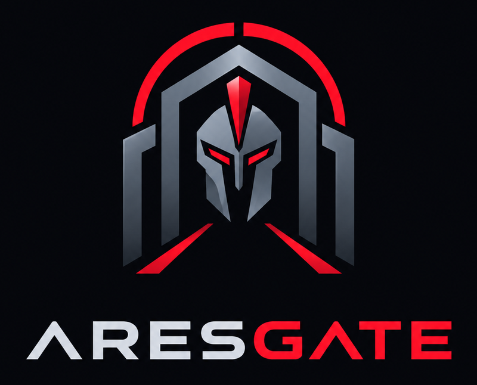

<p align="center">
  
</p>

<p align="center">
  <a href="https://github.com/brianbaggs35/AresGate/actions/workflows/ci.yml"></a>
  <a href="https://github.com/brianbaggs35/AresGate/actions/workflows/codeql.yml"></a>
  <a href="https://sonarcloud.io/summary/new_code?id=brianbaggs35_AresGate"></a>
</p>

# AresGate

AresGate watches your home network the way a security analyst would. It reads what your
firewall and monitoring tools see, works out which of it matters, and tells you in plain
language, so you look at a handful of real problems instead of thousands of log lines.

It is self-hosted: one container that you run on your own hardware. The plan is that nothing
leaves your network unless you choose a hosted AI provider, and then addresses and host names are
replaced first.

## Status

**AresGate is in early development.** The foundation is in place and the features below are
being built in this order. Nothing here is ready to protect a network yet.

| | |
| --- | --- |
| **Built** | The single hardened container (nginx with TLS 1.3, the API, PostgreSQL and the web app), the status page, light and dark themes, and the test, scanning and release pipeline |
| **Next** | First-run setup, sign-in with an authenticator app and passkeys, an encrypted store for credentials, an audit log |
| **Then** | Connecting OPNsense, ntopng and Wazuh, and an overview dashboard (Suricata and CrowdSec are planned after those) |
| **Goal** | An AI analyst that reads that data around the clock, explains what it finds, and suggests what to do. It starts read-only: it never changes your firewall |

## Quick start

You need [Docker](https://docs.docker.com/get-docker/) with Compose, and `make`.

```sh
git clone https://github.com/brianbaggs35/AresGate.git
cd AresGate
cp .env.example .env     # set ARESGATE_SERVER_NAME to the name you will browse to
make up
```

Then open `https://<your server name>`. Without a certificate of your own AresGate makes a
self-signed one, so your browser will warn you the first time.

[DOCS/quick-start.md](DOCS/quick-start.md) has the details: certificates, ports, running a
published release instead of building it, and updating.

## Documentation

| | |
| --- | --- |
| [Quick start](DOCS/quick-start.md) | Install, configure and update AresGate |
| [Operations](DOCS/operations.md) | Where the data is, backups and restores, logs, certificates |
| [Security](DOCS/security.md) | How AresGate is hardened and how it is checked |
| [Development](DOCS/development.md) | Working on the code, running the tests, how changes are made |
| [Releasing](DOCS/releasing.md) | How releases and images are published, and how to verify one |
| [Changelog](CHANGELOG.md) | What changed in each release |

## Built with

Python 3.14 and FastAPI, Vue 3 with Vuetify and TypeScript, PostgreSQL 18, and nginx, all in one
container built on [Chainguard's Wolfi](https://www.chainguard.dev/chainguard-images) so security
fixes arrive with a rebuild. Every change is checked by pytest, Vitest and Playwright, pyright
and ESLint, CodeQL, SonarQube Cloud, Trivy and Dependabot.

## Contributing and security

Read [CONTRIBUTING.md](CONTRIBUTING.md) before you open a pull request. To report a
vulnerability, follow [SECURITY.md](SECURITY.md) and please don't open a public issue.
